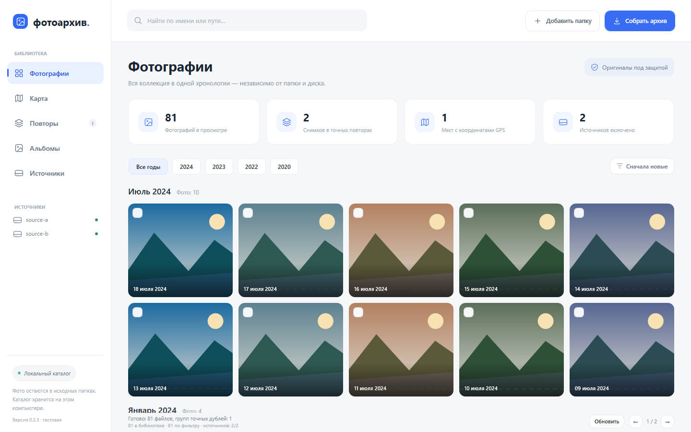
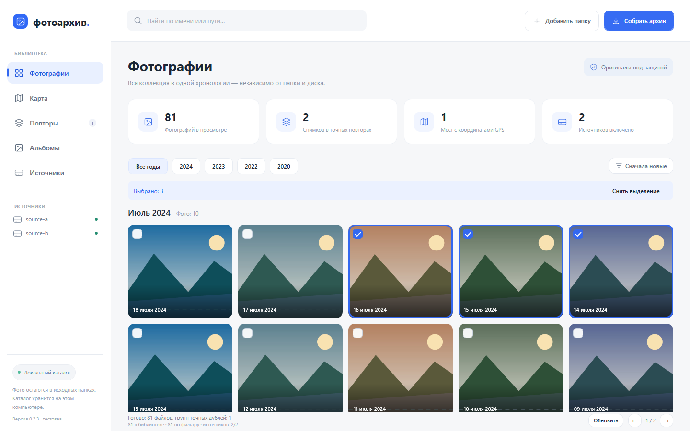
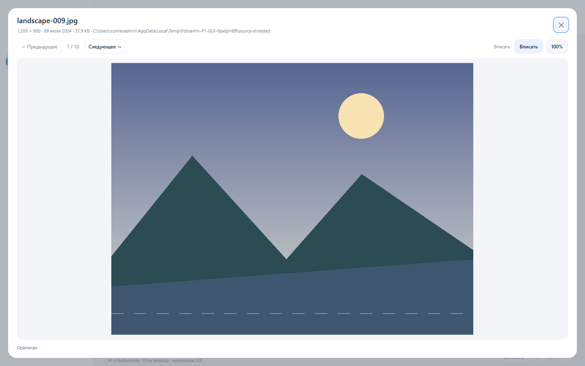
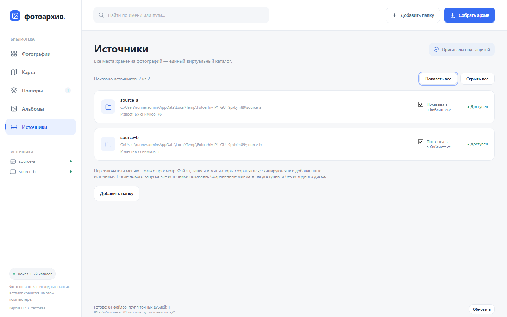
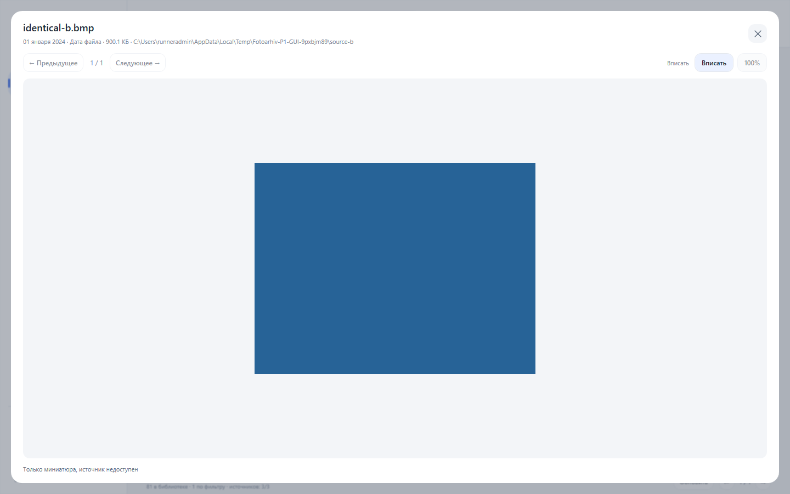

# Настоящие WPF-снимки P1.1

https://github.com/kqh2rnnnmm-dot/Fotoarhiv/actions/runs/41487270281
Commit `492d61033e7ccbe27b3a6e6492ea0cab15145925`, Windows-2025Server-10.0.26100-SP0, DPI 96.

Исходные PNG захвата опубликованного EXE; без подмены HTML или ретуши. На снимках искусственный набор самого теста.

- [01-p1-library.png](01-p1-library.png) — 1440×900, Default chronology with persistent previews and selection checkboxes
- [02-selection.png](02-selection.png) — 1440×900, Multiple real photos selected; no file operations
- [03-oldest.png](03-oldest.png) — 1440×900, Chronology sorted by actual capture date ascending
- [04-viewer-fit.png](04-viewer-fit.png) — 1440×900, Internal original viewer, fit with preserved aspect ratio
- [05-viewer-100.png](05-viewer-100.png) — 1440×900, Native original at 100 percent with scrolling
- [06-all-hidden.png](06-all-hidden.png) — 1440×900, No visible sources; complete catalog remains intact
- [07-source-switches.png](07-source-switches.png) — 1440×900, Registered sources, independent visibility and availability
- [08-offline-preview.png](08-offline-preview.png) — 1440×900, Persistent thumbnail of absent synthetic source, explicit offline indicator
- [09-offline-viewer.png](09-offline-viewer.png) — 1440×900, Only a cached thumbnail; original and 100 percent unavailable
- [10-stress-page.png](10-stress-page.png) — 1440×900, Actual 1000-image query, bounded 72-record page
- [11-large-original.png](11-large-original.png) — 1440×900, 54MP synthetic input decoded within declared 32MP/8192 limit
- [layout-1366x768.png](layout-1366x768.png) — 1366×768, Actual client 1366x768; effective-workspace simulation, system DPI unchanged
- [layout-effective-125.png](layout-effective-125.png) — 1093×614, Actual client 1093x614; effective-workspace simulation, system DPI unchanged
- [layout-effective-150.png](layout-effective-150.png) — 911×512, Actual client 911x512; effective-workspace simulation, system DPI unchanged

Два уменьшенных рабочих пространства — симуляция компоновки, не фактический системный масштаб 125%/150%.

